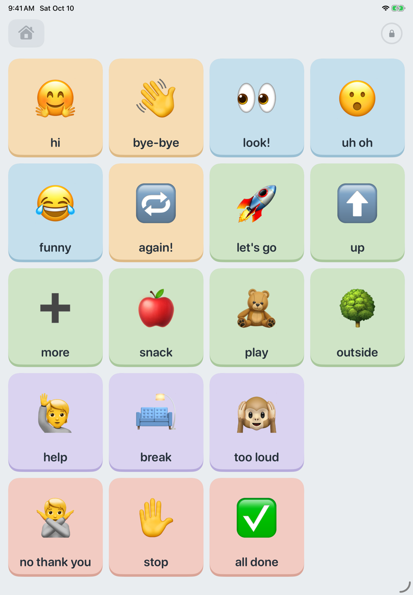
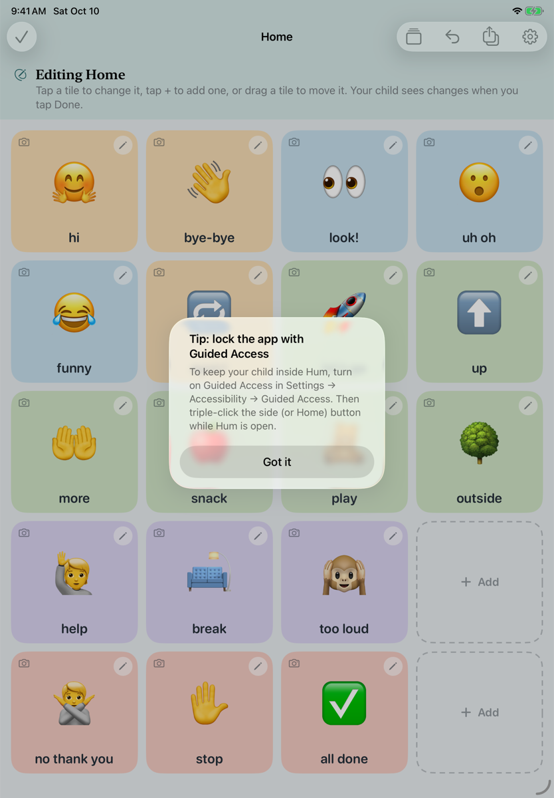
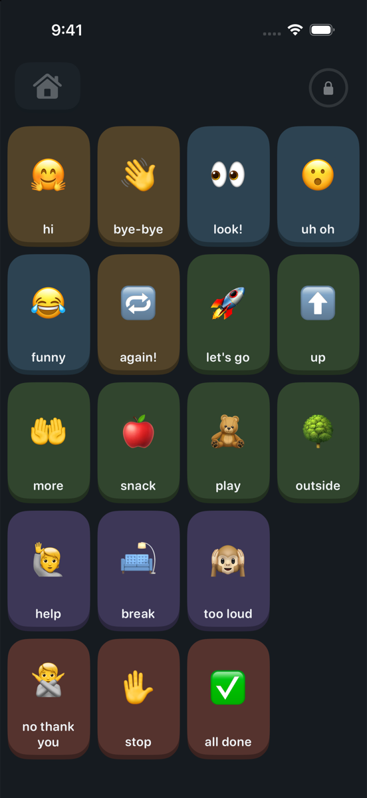

# Hum

**A free, open-source AAC app for Gestalt Language Processors.** iPhone, iPad and Mac.

Hum is an Augmentative and Alternative Communication (AAC) app for autistic children (about ages
2–8) who are minimally speaking and learn language in **whole phrases**, or *gestalts*. A child might
say "let's get out of here!" (from a movie) to mean "I want to leave". Most AAC apps are built around
single core words. Hum is built around whole phrases: **one tile = one whole gestalt**.

> Status: early development. Not on the App Store yet.

| Child's board (iPad) | Grown-up editing | Dark mode (iPhone) |
|---|---|---|
|  |  |  |

## Promises

- **Free forever.** No ads, no in-app purchases, no subscriptions, no "pro" tier.
- **Collects nothing.** No analytics, no tracking, no accounts, no developer servers, no third-party
  SDKs. Works fully offline. App Store label: *Data Not Collected*. The only network uses are optional
  and started by a parent: iCloud sync, Apple Private Cloud Compute, and searching the free ARASAAC
  symbol library (only the search word is sent; the chosen symbol is saved in the tile).
- **Neurodiversity-affirming and non-behavioral.** No stars, tokens, streaks, "good job!" sounds or
  confetti. A tap speaks, and that's all.
- **Never gates communication.** No tile is ever locked, timed out or earned. "No", "stop" and
  "all done" are as big as every other tile, and they're always on Home.
- **Tiles never move on their own.** Imports, syncing and AI suggestions never shuffle a child's board.
- **Instant sound.** Speech is pre-rendered and played through an always-open audio engine. Tapping the
  same tile ten times a second makes ten sounds, because repeated tapping is valid (and can be stimming).

## Gestalt Language Processing, briefly

In the Natural Language Acquisition (NLA) framework (Marge Blanc), GLPs move through stages:
whole gestalts → mixing parts of gestalts → single words → their own grammar. Hum starts at Stage 1:
parents add the child's own phrases as whole tiles, with real photos and, optionally, a recording
in the parent's own voice (intonation carries meaning for gestalts). A sentence strip for later
stages is available but off by default.

## Make boards with a coding agent

The whole setup is one open file format (`hum.json`, or a zipped `.hum` with photos), documented
for humans **and** AI coding agents:

- Guide: [`docs/CONFIG.md`](docs/CONFIG.md) · Schema: [`schema/hum.schema.json`](schema/hum.schema.json)
- Agent rules: [`AGENTS.md`](AGENTS.md)
- CLI: `swift run --package-path Packages/HumConfig hum-config validate|pack|unpack`

Ask an agent, for example *"Add a Trains board with 'all aboard!' to my setup, keep every tile where it
is"*, then import the file into Hum. You'll see a preview before anything changes.

## Building

Requires Xcode 27 (iOS/iPadOS 17+, macOS 14+ deployment targets).

```bash
open hum-aac-ios.xcodeproj            # scheme "Hum", run on My Mac or an iPad simulator
swift test --package-path Packages/HumConfig
```

No third-party dependencies. See [`docs/PLAN.md`](docs/PLAN.md) for architecture and milestones,
and [`CONTRIBUTING.md`](CONTRIBUTING.md) to help.

## Privacy

Hum stores boards on your device. If a parent turns on iCloud sync, boards go to **your own private
iCloud database**, which the developers can't see. If a parent turns on the AI helper (Apple
Intelligence), only the parent's text request and tile text are processed, on device or with Apple's
Private Cloud Compute. Photos and recordings are never sent to any model. The optional history of what
was said stays on the device (never exported or synced) and a parent can clear it. Nothing is collected by us.

## License

[Apache-2.0](LICENSE)
